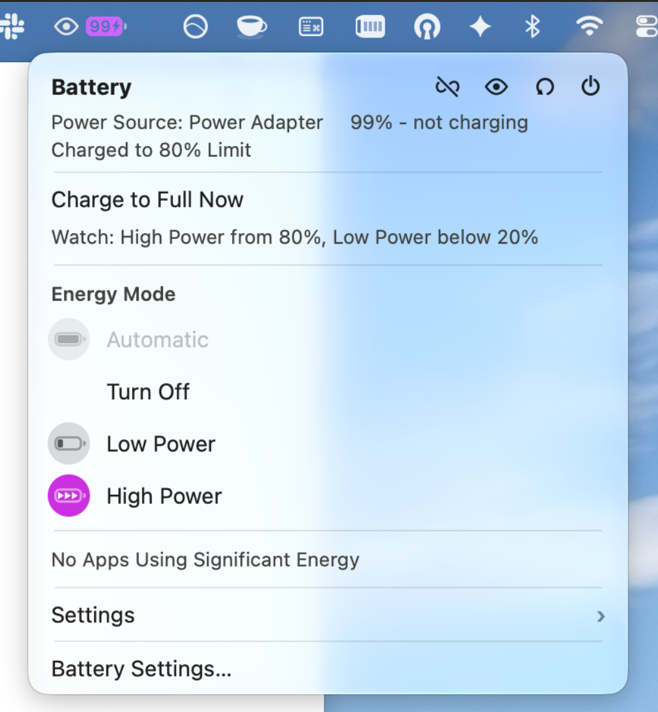
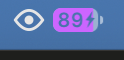
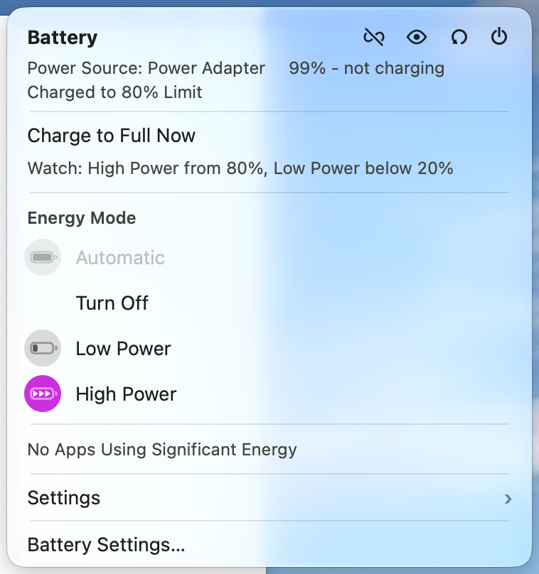
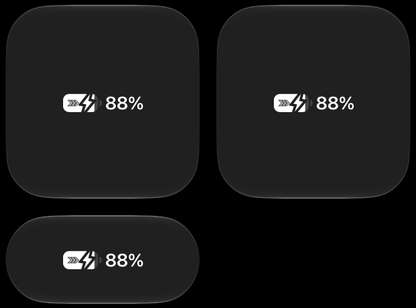

# mbatterier

**Requires macOS 26 or later, Go 1.27 or later, and Xcode for the menu bar app
(details under [Prerequisites](#prerequisites)).** Developed and tested on macOS
27 with Go 1.27.3 and Xcode's Swift 6.4.

mbatterier keeps a MacBook in Low Power by default and gives you High Power
only when you ask for it or the battery is full enough. macOS has no way to
say "High Power for an hour" or "High Power while the charge is high", so
battery life is lost to a mode left on. mbatterier makes those switches:
`boost` turns on High Power for a while, `watch` switches by battery charge.
It comes as a CLI (`mbat`), an Alfred workflow, a menu bar app and a Control
Center control.

<p>
  
</p>

## Prerequisites

| What | Version | Needed for |
|---|---|---|
| macOS | 26 or later (tested on 27) | everything. The Control Center control needs 26; nothing has been tested below 27. |
| A Mac with High Power mode | Apple's list: some MacBook Pro models with M-series Max (and some Pro) chips | `boost` and High Power. Without it, mbatterier still switches Low Power and Automatic. |
| Go | 1.27 or later (`go.mod`) | the CLI. Install with `brew install go`. |
| Homebrew | any | installing and updating Go (`brew upgrade go`). Optional if you get Go elsewhere. |
| Xcode | with Swift 6.4 and the macOS 26 SDK or later | the menu bar app and the control: `swiftc`, `actool` and `appintentsmetadataprocessor` come with Xcode, not with the Command Line Tools alone. Select it with `sudo xcode-select -s /Applications/Xcode.app`. |
| python3 | any 3.x (comes with Xcode) | generating the Alfred icons and the Control Center symbols. Standard library only. |
| Apple Development certificate | any, in your keychain | signing the menu bar app (the App Group needs a team). See [Your Team ID](#your-team-id). |
| Alfred with Powerpack | any with workflows | the Alfred workflow only. |

No third-party Go modules or Python packages are used.

## Install

```sh
make install-system        # root-owned /usr/local/bin/mbatterier + mbat (sudo)
make TEAM=<your team ID> install-menulet   # menu bar app in ~/Applications, starts at login
make install-agent         # optional: run `mbat watch` at boot
```

Run `make install-system` again after every rebuild: Alfred, the menu bar app
and the daemon all run that copy.

### Your Team ID

The menu bar app is signed with your own Apple Development certificate, and
`make menulet` / `make install-menulet` need the Team ID of that certificate in
`TEAM`. The CLI, the Alfred workflow and the daemon don't need it.

**1. Get a certificate, if you have none.** Check first:

```sh
security find-identity -v -p codesigning
#   1) 0123…CDEF "Apple Development: Your Name (A1B2C3D4E5)"
```

If no `Apple Development` line shows, open Xcode → Settings → Accounts, add
your Apple ID, select the team, click **Manage Certificates…**, then **+** →
**Apple Development**. Xcode puts the certificate in your login keychain.

**2. Read the Team ID from it.** It is the certificate's `OU`:

```sh
security find-certificate -c "Apple Development" -p | openssl x509 -noout -subject
# subject=... CN=Apple Development: Your Name (A1B2C3D4E5), OU=ABCDE12345, ...
```

Here `TEAM` is `ABCDE12345`. The id in parentheses after your name
(`A1B2C3D4E5`) is not it, and the build won't work with that one. With a paid
developer account, the same ID is also listed under Membership details at
[developer.apple.com/account](https://developer.apple.com/account).

If you have certificates for more than one team, `find-certificate` shows the
first one. Pick one from the `find-identity` list and pass its full name as
`SIGN_ID`, together with its team:

```sh
make SIGN_ID="Apple Development: Your Name (A1B2C3D4E5)" TEAM=ABCDE12345 install-menulet
```

**3. Save it**, so you don't have to type it every time. The Makefile reads
`.env` at the repo root, and git ignores that file:

```sh
echo 'TEAM=ABCDE12345' > .env
make install-menulet
```

### Passwordless sudo

`boost`, `watch`, `low`, `off` and `energy` need root and re-run themselves through
`sudo`. Alfred and the menu bar app have no terminal, so they need a rule:

```sh
echo "$(whoami) ALL=(root) NOPASSWD: /usr/local/bin/mbatterier, /usr/local/bin/mbat" > /tmp/mbat.sudoers
visudo -cf /tmp/mbat.sudoers && sudo install -o root -g wheel -m 0440 /tmp/mbat.sudoers /etc/sudoers.d/mbatterier
rm /tmp/mbat.sudoers
sudo -k && mbat low        # must not ask for a password
```

Only put this rule on the root-owned copy, never on a binary you can write to.
Undo: `sudo rm /etc/sudoers.d/mbatterier`.

## Usage

```sh
mbat boost                     # High Power for 1h, battery + adapter
mbat boost 2h                  # any duration: 30m, 90m, 1h30m
mbat boost 1h -b               # battery only (-c: adapter only)
mbat boost 2h -k               # keep: ignore plugging and unplugging
mbat boost unplug              # until the adapter is unplugged
mbat boost always              # until stopped, unplugged or not
mbat boost stop                # stop the boost, keep the current mode
mbat watch                     # High from 80%, Low below 20%
mbat watch --high 90 --low 15  # own thresholds
mbat watch stop                # stop the watcher, keep the current mode
mbat low                       # stop boost + watcher, Low Power
mbat off                       # stop boost + watcher, Automatic (macOS decides)
mbat status [--json]           # modes, running boost and watcher
mbat energy [--json]           # your apps using significant energy (needs root)
mbat charge full               # charge to full now, past the charge limit
```

Add `-d` / `--detach` to `boost` or `watch` to run in the background. Output
goes to `/var/log/mbatterier.log`.

## Rules

**Boost**
- Ends in Low Power: on time-out, Ctrl-C, SIGTERM or `mbat low`.
- Unplugging ends it after a 1-minute grace (checked every 5 s). Plug back in
  within the minute and it carries on. A boost started on battery arms this on
  the first plug-in.
- `-b`, `-k` and `always` ignore the adapter.
- One boost at a time: a new one replaces the running one.

**Watch**
- Acts on crossings: High Power at ≥ 80%, Low Power below 20%, the mode is left
  alone in between. Checked every minute.
- Ignores the power source: High Power raised at 80% stays on after unplugging,
  down to 20%.
- Stands back while a boost runs, including below 20%. Re-reads the charge
  once the boost is gone.
- Stops in Low Power, except `mbat watch stop`, which keeps the mode.

**Changing the mode in macOS** (Control Center, System Settings) stops a running
boost and watcher within a second and leaves your choice in place. The
LaunchDaemon stays stopped after that; restart it with
`sudo launchctl kickstart system/it.blommesteijn.mbatterier.watch`.

**Crashes:** `kill -9` skips the revert; run `mbat low`. Locks are released by
the OS, so a crash never blocks the next run.

## Apps using significant energy

`mbat energy` lists your apps whose *Energy Impact* is 550 or more, highest
first, at most two. Usually it prints nothing but `No apps using significant
energy`:

```
Terminal  11057.9
```

**This approximates the "Using Significant Energy" list of the macOS Battery
menu; it is not Apple's logic.** Apple does not document that list, so the rule
was fitted from watching the real menu next to `powermetrics` while a test load
ran:

- **Metric:** Energy Impact from `powermetrics`, the figure of Activity
  Monitor's Energy tab, summed per *coalition*. A coalition is how macOS groups
  an app with the processes it starts, so a terminal's child processes count for
  the terminal.
- **Only apps with a Dock icon, and only yours.** Background-only apps
  (`LSUIElement`/`LSBackgroundOnly` in their `Info.plist`, such as MenuBarAgent)
  and root daemons are never listed, as in Apple's menu.
- **A peak hold of two minutes.** Watching the real menu and its log, a new
  burst was listed within 12 seconds, and an app that stopped was still listed
  102 seconds later and gone 181 seconds later. So the list is "reached the
  threshold within the last two minutes", not an average. `mbat energy`
  remembers when each app was last over the line in
  `/var/run/mbatterier.energy.json`. Apple also recomputes only about once a
  minute, and so does the menu.
- **Threshold 550, from one 15-second sample.** Apple dropped VS Code, which idles
  at about 450, while a fresh reading was 498, and listed it after readings of
  580 and 811, so the line is above 500. The exact value is a guess. The
  threshold, `Hold` and `MaxApps` are in `src/internal/energy/`, with the
  evidence. A burst that falls between two samples is missed, because nothing
  samples between menu openings.
- **Needs root**, because `powermetrics` does. Like `boost`, the command re-runs
  itself through `sudo`, so the menu bar app needs the
  [passwordless sudo rule](#passwordless-sudo). `status` stays root-free.
- **Takes 15 seconds**, so it is a command of its own and not part of
  `status`.

## Menu bar app

Shows the charge, the power mode as a colour (purple High, yellow Low, plain
Automatic) and what mbatterier is doing.

<p>
  
</p>
<p>
  
</p>

- **Bar:** battery with charge and bolt, High Power chevrons, ⏱ countdown for a
  timed boost, 👁 while watching, ∞ for an always-on boost.
- **Menu:** power source (or *Slow Charger*), charge, time to full, charge
  limit in macOS's words (*Charging to 80% Limit*, *Charged to 80% Limit*,
  *Charging to 100% Limit* after Charge to Full Now), *Charge to Full Now*
  while the charge is held short of full (see below), Energy Mode rows (Automatic / Turn Off / Low / High), *Using
  Significant Energy* (up to two apps with their icons, or *No Apps Using
  Significant Energy*; an approximation of Apple's list, see above; click an
  app to see it selected in Activity Monitor, which needs MBatterier allowed
  under Privacy & Security → Accessibility),
  Settings.
- **Header buttons:** ∞ always-on boost, 👁 watch mode, reload, quit. Hover
  for a tip.
- **Watch mode** is on by default: the app starts a watcher at launch unless
  you turned it off.
- **Settings → Menu Bar:** remaining time, boost countdown, watch icon,
  always-on icon, High Power icon, monochrome colours. With monochrome on, each
  shown icon can keep its mode colour instead. *High Power Battery in Color* and *Low Power Battery in Color* do the same for the battery icon.

The energy list is read from `mbatterier energy --json` when the menu opens, at
most once a minute (Apple's recomputes about as often), not on the 15 s timer:
sampling takes 15 seconds. The previous list shows until the new one arrives, so
it can be up to a minute old. The section is always there:
with no app it is the single line *No Apps Using Significant Energy*, without
the heading. A failed read, say because the sudo rule is missing, shows that
same line, so an empty list can also mean it could not be read; check
`sudo -n mbatterier energy` if you expect an app.

**Charge to Full Now** works like the item in macOS's Battery menu, and shows
when macOS's would: on the adapter, while the charge limit set in System
Settings holds the battery (held at the limit, or draining down to it), or
while Optimized Battery Charging holds it. Clicking it lets the battery charge
to 100% until the limit next engages; macOS can take up to a minute to start
charging. From a terminal: `mbat charge full`. Both ask macOS's private PowerUI
framework through `osascript`, the way Control Center does, and need no root.
Checked against macOS's own menu for the charge limit; the Optimized Battery
Charging case is untested.

The app reads everything from `mbatterier status --json` and never sets power
itself: it runs the same commands as the terminal. It refreshes on plug and
unplug, on mode changes, when a boost or watcher starts or stops, and every
15 s as a fallback.

## Control Center

The menu bar app brings a **Battery** control for Control Center (macOS 26+),
after Apple's own: the battery alone in the small size, battery and charge in
the medium and large ones, yellow in Low Power and purple in High Power (the
menu bar's Monochrome settings apply). Tapping it opens the MBatterier menu.
Add it with Control Center → Edit Controls → MBatterier.

<p>
  
</p>

- It shows what the menu bar app last read, so it needs the app running. With
  no reading it shows `—`.
- The battery is the menu bar's, redrawn as custom symbols in 5% steps
  (`tools/symbols.py`, `make symbols`), since controls draw symbols only. Control
  Center draws it in its own colour; the mode colour shows while pressed. So
  the mode is also marked on the battery with the menu bar's chevrons: one in
  Low Power, three in High Power, beside the bolt on the adapter. The marks
  follow the mode whatever the Monochrome settings.
- **Battery (Centred)** and **Battery (Centred, Large)** lay it out like
  Apple's medium and large tiles: battery and charge 3pt apart, centred.
  Control Center puts a control's icon and title at fixed spots, so these draw
  both as one symbol, with room on its left and, for the large one, lower down
  (`tools/symbols.py`, the digits from the system font via
  `menulets/MBatteryControl/glyphs.swift`). Use each in its own size, which is
  also the size Edit Controls shows it in; keep **Battery** for the small one,
  where the room pushes the others out of the circle.
- **Signing (`TEAM`, required).** `make menulet` and `make install-menulet`
  sign with your Apple Development certificate (`SIGN_ID`, default `Apple
  Development`) and need your Apple Developer Team ID in `TEAM`; there is no
  default, and the build stops without it. The app and the control share an
  App Group named `<TEAM>.it.blommesteijn.mbatterier`, and macOS only lets them share it
  when it starts with the team of the certificate that signed them. Where to
  find the ID, and how to save it in `.env`, is under
  [Your Team ID](#your-team-id).
- If the tile shows a dashed app placeholder, open Control Center → Edit
  Controls once. macOS doesn't cache a development-signed control, so after
  Control Center restarts it only finds the control again from there.

## Alfred

Keyword `mbat`: presets (30m, 1h, 2h), `unplug`, `always`, `watch`, `status`,
`low`. Any duration works (`mbat 90m`). On boost rows ⌘↩ adds `-k`, ⌥↩ `-b`,
⌃↩ `-c`.

Needs the Powerpack, `make install-system` and the sudo rule. Import with:

```sh
make alfred && open mbatterier.alfredworkflow
```

"mbatterier is missing": run `make install-system`. "mbatterier failed": the subtitle holds the error. "Password is
required": fix the sudo rule. Debug with the bug icon in the workflow editor.

## `status --json`

| Field | Meaning |
|---|---|
| `percent` | charge, `-1` without a battery |
| `on_ac`, `charging` | on the adapter; taking charge (false at a charge limit) |
| `remaining_minutes` | pmset estimate, `0` = unknown |
| `modes` | `battery` and `ac`: `automatic`, `low` or `high` |
| `charge_limit` | the limit the menu's line names, in %: the one from System Settings, or 100 after Charge to Full Now; absent if none |
| `slow_charger` | macOS's own "Slow Charger" verdict, only on the adapter |
| `charge_to_full` | macOS's Battery menu would offer "Charge to Full Now"; `mbat charge full` does it |
| `boost` | `label`, `remaining_seconds`, `until_unplug` or `always` |
| `watch` | `label` with the thresholds |

## `energy --json`

`{"apps": [{"name": "Music", "impact": 24.5}]}`, highest impact first; `apps` is
`[]` when no app reaches 550.

## Make targets

| Target | Does |
|---|---|
| `build`, `test`, `vet`, `vuln`, `check` | build; tests; gofmt + vet; govulncheck; all three |
| `install-system` | root-owned copy in `/usr/local/bin` |
| `install-agent` / `uninstall-agent` | the `mbat watch` LaunchDaemon |
| `menulet` / `install-menulet` / `uninstall-menulet` | the menu bar app (`menulet` and `install-menulet` need `TEAM=<team ID>`) |
| `reload-control` | after an install: restart the control's extension and Control Center, if the control still runs old code or shows old symbols; open Edit Controls after it |
| `alfred`, `icon` | build the workflow; re-render `alfred/*.png` |
| `symbols` | regenerate the Control Center battery symbols (`menulet` makes them when missing or out of date; not committed) |
| `clean` | remove build output |

## Layout

```
src/cmd/mbatterier/   CLI, watcher, Alfred JSON
src/internal/pmset/     pmset: modes, power source, charge
src/internal/charging/  charge limit and slow-charger state
src/internal/energy/    apps using significant energy, from powermetrics and ps
src/internal/runstate/  locks + state in /var/run, one boost and one watcher
menulets/               the menu bar app and Control Center control (the only Swift)
alfred/                 the workflow, exactly as shipped
launchd/                the watch LaunchDaemon
tools/icon.py           the Alfred icons, Python stdlib only
tools/symbols.py        the Control Center battery symbols, Python stdlib only
docs/                   the README's screenshots
```

## Security

- Root code is this module plus the Go standard library, no dependencies.
- External tools (`pmset`, `plutil`, `notifyutil`) are called by absolute path.
- Locks and state live in root-owned `/var/run`, the daemon plist is root-owned.
- The menu bar app runs as you and execs only `/usr/local/bin/mbatterier`.
- Keep Go patched and run `make check` before installing.

## Future work

- **Low Power setting in Alfred.** The workflow can switch to Low Power (`low`),
  but the Low Power setting itself can't be changed from Alfred yet.
- **Apps using significant energy.** Improve the list: it takes 15 seconds,
  misses bursts between two samples, and its threshold is a guess (see
  [Apps using significant energy](#apps-using-significant-energy)). Add a
  setting to show more than two apps.
- **Menu bar highlight.** While the menu is open, the menu bar item's highlight
  copies the glass look of Control Center instead of the normal menu bar
  highlight.

## License

MIT, see [LICENSE](LICENSE).
